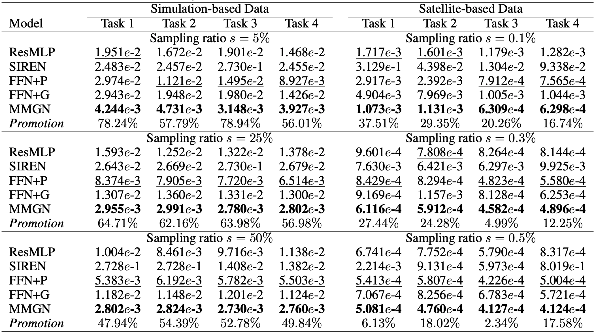
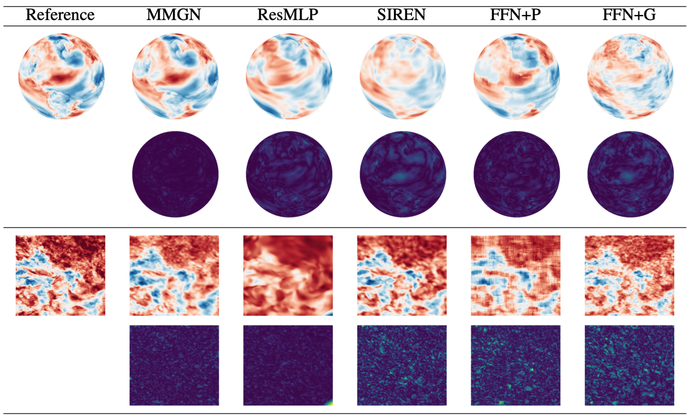

<div align="center">

# Continuous Field Reconstruction from Sparse Observations with Implicit Neural Networks (ICLR 2024)

<a href="https://pytorch.org/get-started/locally/"></a>
<a href="https://pytorch.org/get-started/locally/"></a>
<a href="https://pytorchlightning.ai/"></a>
<a href="https://hydra.cc/"></a>

<h3> ✨Official implementation of our <a href="https://openreview.net/forum?id=kuTZMZdCPZ">MMGN</a> model✨ </h3>
 
</div>

## 本项目目录与入口

本地项目在原始 MMGN 实现上包含流场重建、第二章噪声增强、潜变量消融、浮标仿真和论文写作材料。

| 目录 | 内容 |
| --- | --- |
| `models/`、`dataloaders/`、`configs/` | 模型、数据加载与 Hydra 配置 |
| `experiments/` | 第二章噪声增强、latent 分析、浮标仿真代码 |
| `scripts/` | 数据处理、模型评估、绘图和训练启动脚本 |
| `matlab/` | MATLAB 性能对比与采样示意图脚本 |
| `data/` | 原始 NetCDF、处理后的流场、仿真数据、对比指标 CSV |
| `outputs/` | 训练日志、checkpoint、实验指标与生成图表 |
| `docs/` | 论文文稿、文档工具、图片与项目说明 |

完整目录、迁移表和使用约定见 [目录说明](docs/PROJECT_STRUCTURE.md)；已有图表见 [结果索引](docs/RESULTS.md)。

常用命令（在项目根目录运行）：

```bash
# MMGN 单次训练：选择与模型一致的数据加载方式
python main.py model=MMGNet datamodule.model_name=MMGN

# MMGN 批量实验
bash scripts/train/MMGN.sh

# 第二章小规模检查；单独输出，保留论文实验结果
python -m experiments.chapter2.noiseEnhance.run_focused_experiments --quick --out outputs/chapter2_quick_check

# 浮标仿真 TCN 评估：使用现有仿真数据和参考权重
python -m experiments.simulate.eval_report --out_dir outputs/simulate/check_eval
```

训练数据默认是 `data/current/bohai.npz`，训练日志位于 `outputs/training/`。运行完整实验前需准备对应的 Python/PyTorch 环境；训练设备和日志服务见 `configs/trainer/` 与 `configs/logger/`。

## Abstract

Reliably reconstructing physical fields from sparse sensor data is a challenge that frequently arises in many scientific domains. In practice, the process generating the data often is not understood to sufficient accuracy. Therefore, there is a growing interest in using the deep neural network route to address the problem. This work presents a novel approach that learns a continuous representation of the physical field using implicit neural representations (INRs). Specifically, after factorizing spatiotemporal variability into spatial and temporal components using the separation of variables technique, the method learns relevant basis functions from sparsely sampled irregular data points to develop a continuous representation of the data. In experimental evaluations, the proposed model outperforms recent INR methods, offering superior reconstruction quality on simulation data from a state-of-the-art climate model and a second dataset that comprises ultra-high resolution satellite-based sea surface temperature fields.

For more information, please refer to the following:

- Xihaier Luo and Wei Xu and Balu Nadiga and Yihui Ren and Shinjae Yoo. "[Continuous Field Reconstruction from Sparse Observations with Implicit Neural Networks](https://openreview.net/forum?id=kuTZMZdCPZ)." (ICLR 2024).

## Setting it up

First, clone the project.

```bash
# clone project
git clone https://github.com/Xihaier/Continuous-Field-Reconstruction-MMGN.git
cd Continuous-Field-Reconstruction-MMGN
```

Then, install the needed dependencies.

```bash
# install dependencies
# Install PyTorch appropriate for your platform first.
python -m pip install -r requirements.txt
```

## Get Started

1. Prepare the Data: To access the experimental datasets, please use the following link. After downloading, unzip the file to reveal two datasets referenced in the paper. These datasets should be placed in the data folder.

| Dataset | Link |
| -------------------------------------------- | ------------------------------------------------------------ |
| Simulation-based global surface temperature | [[Google Cloud]](https://drive.google.com/file/d/1V8DvkcWZrW2Z_4eaz4VjtMU8IvcLyyMe/view) |
| Satellite-based sea surface temperature | [[Google Cloud]](https://drive.google.com/file/d/1V8DvkcWZrW2Z_4eaz4VjtMU8IvcLyyMe/view) |

2. Model Training and Evaluation: Run `bash scripts/train/MMGN.sh` for MMGN, `bash scripts/train/FFN.sh` for Fourier-feature baselines, or `bash scripts/train/MLP_SIR.sh` for ResMLP and SIREN. Edit the corresponding script to select tasks and sampling rates.

```bash
bash scripts/train/MMGN.sh
```

## Quantitative Results

Performance comparison with four INR baselines on both high-fidelity climate simulation data and real-world satellite-based benchmarks. MSE is recorded. A smaller MSE denotes superior performance. For clarity, we highlight the best result in bold and underline the second-best. We have also included the promotion metric, which indicates the reduction in relative error compared to the second-best model for each task.

<p align="center">

<br><br>
<b>Table 1.</b> Model performance.
</p>

## Qualitative Results

Visualizations of true and reconstructed fields: (1) global surface temperature derived from multi-scale high-fidelity climate simulations and (2) sea surface temperature assimilated using satellite imagery observations. For each dataset, the first column displays the ground truth, the first row showcases predictions from different models, and the second row presents corresponding error maps relative to the reference data. In the error maps, darker pixels indicate lower error levels.

<p align="center">

<br><br>
<b>Figure 3.</b> Showcases.
</p>

## Citation

If you find this repo useful, please cite our paper. 

```
@inproceedings{
luo2024continuous,
title={Continuous Field Reconstruction from Sparse Observations with Implicit Neural Networks},
author={Xihaier Luo and Wei Xu and Balu Nadiga and Yihui Ren and Shinjae Yoo},
booktitle={The Twelfth International Conference on Learning Representations},
year={2024},
url={https://openreview.net/forum?id=kuTZMZdCPZ}
}
```

## Contact

If you have any questions or want to use the code, please contact [xluo@bnl.gov](mailto:xluo@bnl.gov).
